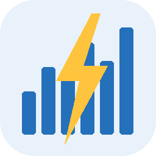

<p align="center">
  
</p>

<h1 align="center">Moj Elektro Plus</h1>

<p align="center">
  Your Slovenian electricity meter, 15 minutes at a time, in Home Assistant.
</p>

<p align="center">
  <a href="https://github.com/astritzeqiri/moj-elektro-plus-ha/releases/latest"></a>
  <a href="https://www.home-assistant.io/integrations/marketplace/"></a>
  <a href="https://www.hacs.xyz/"></a>
  <a href="https://github.com/astritzeqiri/moj-elektro-plus-ha/actions/workflows/validate.yml"></a>
  <a href="LICENSE"></a>
</p>

Bring your **Moj Elektro** meter data into Home Assistant: 15-minute readings, up to two years of history, the **Energy dashboard** at the right times, and a **Moj Elektro** page in the sidebar with charts, summaries and CSV export.

**The integration, the sidebar page and the Energy dashboard statistics come together in one install.** There is no extra card, YAML or add-on to set up.

> [!NOTE]
> **Readings are delayed.** Moj Elektro publishes them with a delay, usually the next day and sometimes later. 15-minute values are not live, and refreshing more often does not make them arrive sooner.

## Features

- **Set up in the UI** — your API token and meter ID, checked before anything is saved. Add as many meters as you like; each is its own entry.
- **History** — up to two years, downloaded in the background month by month. Progress shows on the sidebar page, and a restart picks up where it stopped.
- **Late readings and corrections** — every refresh re-reads the last 7 days, so readings Moj Elektro adds or corrects later replace the old values instead of being counted twice.
- **Energy dashboard** — hourly statistics placed at the hour the energy was used, never at download time, so yesterday's consumption never shows up as a spike today.
- **The Moj Elektro page** — latest day, last 7 or 30 days, this or last month, last 12 months or any range. 15-minute, daily and monthly charts, a data table, and CSV export.
- **Honest numbers** — missing readings stay missing (never zero), partial periods are labelled with their coverage, and Moj Elektro's quality flags (estimated, unread, …) are shown.
- **Import and export** — exported energy appears when your meter reports it. A meter without an export register says so instead of showing zero.
- **Slovenian time** — days and months follow Europe/Ljubljana whatever timezone Home Assistant runs in, including daylight-saving days with 92 or 100 intervals.
- **Private** — your token stays on the Home Assistant server; the browser, logs and diagnostics never see it.
- **English and Slovenian.**

## Installation

You'll need a Home Assistant administrator account. The repository declares Home Assistant **2026.3.0** as its minimum version; runtime checks have been performed on **Core 2026.11.0**.

Since **Home Assistant 2026.11**, HACS is built in as the **Marketplace** (**Settings → Marketplace**); there is nothing extra to install. On older versions, use [HACS](https://www.hacs.xyz/docs/use/). Both use this repository the same way.

### 1. Download the integration

#### Home Assistant 2026.11 or newer: Marketplace

[](https://my.home-assistant.io/redirect/marketplace_repository/?owner=astritzeqiri&repository=moj-elektro-plus-ha&category=integration)

Open the button above. Because this repository is added from a link (it is not in the catalog yet), Home Assistant first asks you to **Connect GitHub**: you get a code to enter on GitHub, and you never type your GitHub password into Home Assistant. Then open the button again, select **Install**, check the version, and select **Install** again.

<details>
<summary>Add the repository in the Marketplace manually</summary>

1. Go to **Settings → Marketplace**.
2. Select **Add from link** (upper right).
3. Under **GitHub link**, enter `https://github.com/astritzeqiri/moj-elektro-plus-ha`, then select **Add**. If you're asked for a **Type**, choose **Integration** and select **Add** again.
4. Open **Moj Elektro Plus** from the list, select **Install**, review the version and select **Install**.

The first time you use the Marketplace, Home Assistant asks you to accept that community projects are not reviewed by the Home Assistant project (**I understand the risks and agree**). Repositories added from a link need the Marketplace's GitHub connection; if you skipped it, set it up under **Settings → Devices & services → Marketplace → ⋮ → Reconfigure**.

If you used HACS before upgrading to 2026.11, an existing install moves to the Marketplace by itself and keeps getting updates.

</details>

#### Home Assistant 2026.3 – 2026.10: HACS

[](https://my.home-assistant.io/redirect/hacs_repository/?owner=astritzeqiri&repository=moj-elektro-plus-ha&category=integration)

Open the button above, add the repository if prompted, then download **Moj Elektro Plus**.

<details>
<summary>Add the repository in HACS manually</summary>

In **HACS → ⋮ → Custom repositories**, enter:

| Setting | Value |
| --- | --- |
| Repository | `https://github.com/astritzeqiri/moj-elektro-plus-ha` |
| Type | **Integration** |

Add the repository, then find **Moj Elektro Plus** in HACS and download it.

</details>

<details>
<summary>Install without the Marketplace or HACS</summary>

Copy `custom_components/mojelektro_plus/` from this repository into your Home Assistant `config/custom_components/` folder.

</details>

### 2. Restart Home Assistant

Restart Home Assistant itself after the download completes. (On 2026.11, the Marketplace may open the setup straight away when no restart is needed; otherwise it offers the restart as a repair.)

### 3. Get your token and meter ID

1. Sign in at [mojelektro.si](https://mojelektro.si).
2. Open **Moj profil → Kreiraj žeton** and create an API token. Copy it.
3. Note your meter identifier (EIMM) under **Merilna mesta**. It looks like `4-93571`.

### 4. Add the integration

[](https://my.home-assistant.io/redirect/config_flow_start/?domain=mojelektro_plus)

Or go to **Settings → Devices & services → Add integration** and search for **Moj Elektro Plus**. Enter the token and meter ID, then submit. Refresh your browser to see **Moj Elektro** in the sidebar.

| Field | Default | Meaning |
| --- | --- | --- |
| API token | — | From **Moj profil → Kreiraj žeton** (input is masked) |
| Meter ID (EIMM) | — | For example `4-93571` |
| Friendly name | `Moj Elektro <meter>` | Name of the device and its entities |
| Historical import | 12 months | Complete calendar months to download, up to 24 |
| Refresh interval | 6 hours | How often to check for new readings, at least 1 hour |
| Show the Moj Elektro sidebar page | on | One shared page for all meters |

If something is wrong, the form says what: invalid token, meter not accessible with this token, invalid meter ID, timeout, rate limited, or a Moj Elektro service error.

Recent days appear within seconds. Older months download in the background over a few minutes.

## The Moj Elektro page

Open **Moj Elektro** in the sidebar. It starts on the **latest day with data**, not on an empty "today".

- **Meter and period** — pick a meter, then a preset (latest day, last 7 days, last 30 days, this month, previous month, last 12 months) or your own dates.
- **Summary** — imported and exported kWh, the daily average (over complete days only), the peak 15-minute average demand and the coverage, with the number of flagged readings.
- **Charts** — 15-minute energy or average power for up to 3 days, daily bars up to 92 days and monthly bars beyond. Missing data and flagged readings are marked. Use the arrow keys on the chart, or **Show table**, to read every value.
- **Status** — latest measurement, last refresh, the delayed-data notice and the history download progress.
- **Refresh** and **Re-download this period** (administrators) fetch new or corrected readings.
- **Export CSV** — UTC and Europe/Ljubljana timestamps, kWh and kW averages, and a status per interval: `ok`, `flagged` or `missing`, with the quality codes.

The page follows your Home Assistant theme and language (English or Slovenian) and works on phones.

## Entities

One device per meter, with:

| Entity | Notes |
| --- | --- |
| Latest interval imported energy | kWh of the most recent available 15-minute interval |
| Latest interval average import power (delayed) | interval kWh × 4 — an average over the interval, not instantaneous power |
| Latest complete day imported energy | the newest day with every interval present |
| This month imported energy (partial) | with coverage attributes |
| Last month imported energy | the `complete` attribute shows whether every interval is present |
| Export equivalents | created only once Moj Elektro returns an export register |
| Latest available reading | when the newest interval ended |
| Last successful refresh, Data age, This month data coverage, History download | diagnostic entities |
| Refresh (button) | checks for new readings now |

None of the energy sensors has a state class, on purpose: Home Assistant would otherwise record yesterday's consumption at the moment it arrives. Long-term history comes from the statistics below.

## Energy dashboard

The integration adds two statistics per meter, at the hours the energy was measured:

- **Imported energy** — `mojelektro_plus:<meter>_energy_consumption`
- **Exported energy** — `mojelektro_plus:<meter>_energy_return` (when your meter reports export)

Go to **Settings → Dashboards → Energy**, add a grid connection, and choose "*name* imported energy" for consumption and "*name* exported energy" for return to grid.

When Moj Elektro adds or corrects readings, the affected hours are rewritten, so restarts and repeated downloads never count anything twice. The Energy dashboard groups days by Home Assistant's own timezone, while the sidebar page uses Europe/Ljubljana days.

## Costs

Not included in this version. Supplier tariffs, network charges (omrežnina), taxes and billing arrangements are not part of meter data, so euro amounts can't be worked out from consumption alone. Home Assistant also does not allow a price to be attached to imported statistics like these.

## History limits

- Moj Elektro serves at most **two years** of history, at most 35 days per request. The default download is 12 complete calendar months plus the current month.
- Local storage is bounded to about 26 months per meter.
- To fetch a period again, use **Re-download this period** on the page, or the action below.

```yaml
# Re-download readings for a date range (Europe/Ljubljana days, both inclusive).
action: mojelektro_plus.refresh_range
data:
  config_entry_id: <your entry>   # pick the meter in the action editor
  start_date: "2026-10-01"
  end_date: "2026-10-31"
```

## Update

Install the new version from **Settings → Marketplace → Moj Elektro Plus** (2026.11+) or **HACS → Moj Elektro Plus** (older versions), restart **Home Assistant** itself, then refresh your browser. Downloaded history and statistics stay in place. See the [changelog](CHANGELOG.md) for what each release changed.

## Change the token or options

- **Token:** **Settings → Devices & services → Moj Elektro Plus → ⋮ → Reconfigure**. When a token stops working, Home Assistant asks for a new one by itself.
- **History, refresh interval and sidebar page:** the entry's **Configure** button.

## Storage, privacy and permissions

- **The token** is stored in Home Assistant's configuration storage (`.storage/core.config_entries`), like other integrations' credentials. Home Assistant does not encrypt that file, so keep your backups safe. The token is only used by the server; it never reaches the browser, entity attributes, logs or diagnostics.
- **Readings** live in `config/.storage/mojelektro_plus.<entry>` and in Home Assistant's statistics, so backups include them.
- **Every signed-in user** can open the Moj Elektro page and see the data. **Refreshing and re-downloading** need an administrator. Nothing is public.

## Removal

**Settings → Devices & services → Moj Elektro Plus → ⋮ → Delete** removes the meter's entities, its stored readings and its Energy statistics (remove it from the Energy dashboard first). The sidebar page disappears with the last meter. Then uninstall it in the Marketplace (repository page → ⋮ → **Uninstall**) or in HACS, and restart.

## Diagnostics and troubleshooting

- **Diagnostics:** **Settings → Devices & services → Moj Elektro Plus → ⋮ → Download diagnostics**. The token, meter ID and GSRN are redacted, so it's safe to attach to bug reports.
- **Data age** is normally 10–40 hours. Larger values usually mean Moj Elektro hasn't published new readings yet.
- **Debug logs:**

  ```yaml
  logger:
    logs:
      custom_components.mojelektro_plus: debug
  ```

## Help and development

- [Report a bug or request a feature](https://github.com/astritzeqiri/moj-elektro-plus-ha/issues)
- [Releases](https://github.com/astritzeqiri/moj-elektro-plus-ha/releases) · [changelog](CHANGELOG.md)
- [Development guide](docs/DEVELOPMENT.md) · [Release process](docs/RELEASING.md)

## Credits

The API behaviour follows the official [Moj Elektro API specification](https://docs.informatika.si/mojelektro/api/mojelektro-openapi.yaml) by Informatika d.o.o. Thanks to [frlequ/homeassistant-mojelektro](https://github.com/frlequ/homeassistant-mojelektro), the first Moj Elektro integration, which was read for context; no code was copied, and the two can be installed side by side. This project is not affiliated with Informatika d.o.o. or the Slovenian distribution companies.

Licensed under the [MIT license](LICENSE). See [NOTICE.md](NOTICE.md) for attribution.
